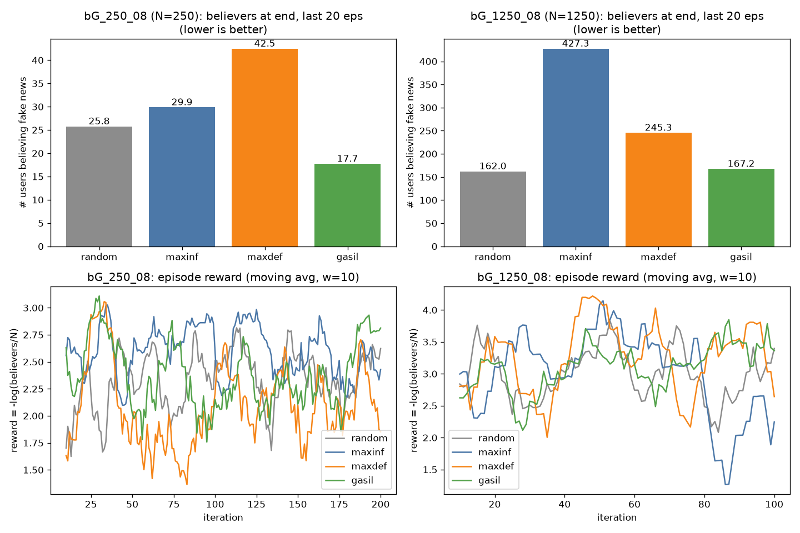
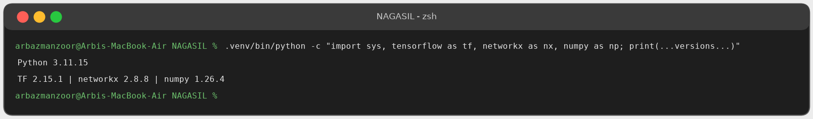
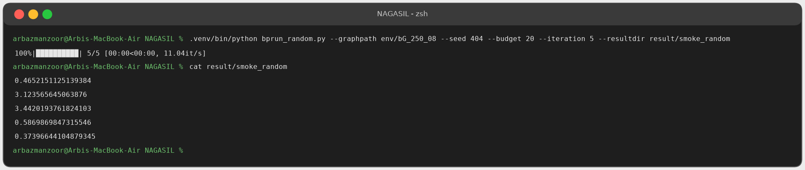
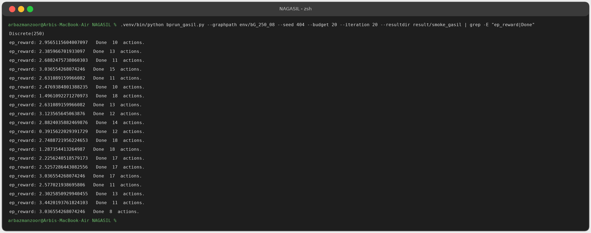
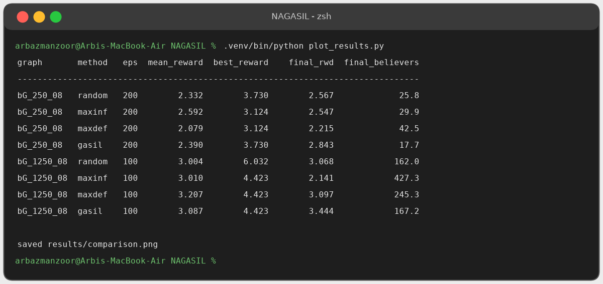

# NAGASIL: Selecting Fake-News Debunkers via Self-Imitation Learning (CPU reproduction)

This repo is a working, CPU-only run of the code for

> **Harnessing Network Effect for Fake News Mitigation: Selecting Debunkers via Self-imitation Learning**
> Xiaofei Xu, Ke Deng, Michael Dann, Xiuzhen Zhang. AAAI 2024. [arXiv:2402.03357](https://arxiv.org/abs/2402.03357)
>
> Original code: <https://github.com/xxfwin/NAGASIL>. All credit for the method, simulator, graphs and code goes to the original authors.

I ported the code from Python 3.6 / TensorFlow 1.13 to Python 3.11 / TensorFlow 2.15 (via `tf.compat.v1`) on an Apple Silicon Mac. Then I ran the main method and three baselines on two of the authors' synthetic social graphs. The runs are small (minutes, not the ~20k core hours the authors used), so these numbers show the pipeline works. They are **not** a reproduction of the paper's tables.

## Problem

Fake news and its correction (debunking news) spread through the same social network. The model behind it is a competing-cascade, SEIR-style simulation: users can be susceptible, exposed, believing the fake news (**I**) or believing the truth (**R**), and influence decays over time. The platform has a **budget** and, over several **stages**, picks users to act as *debunkers* who seed true news. Each user has a cost. The goal is to **minimise the number of users who still believe the fake news** at the end of the simulation.

The paper's point is that what matters is the *network effect*, i.e. the total mitigation the debunkers achieve together. Per-step rewards are unhelpful because a selection only pays off much later. In this setting reinforcement learning gets one sparse, noisy reward per episode:

```
reward = -log(#believers_at_endtime / N)      # higher = fewer believers (10 if nobody believes)
```

## Approach: GASIL / NAGASIL

**GASIL** (Generative Adversarial Self-Imitation Learning) works around the sparse, delayed reward:

1. Roll out the current **PPO policy** (an MLP over a 5N-dim state: fake/true news counts, infection and recovery history, follower counts). It picks one debunker per stage within the budget.
2. Keep a buffer of the **top-20 episodes** by final reward. These are the agent's *own best trajectories*.
3. Train a **discriminator** D(s,a) to tell those good trajectories apart from the current ones (GAIL-style).
4. Use `log D(s,a)` as a **dense per-step reward**, and update the policy with PPO on it.

The agent therefore imitates its own past successes instead of waiting for a single noisy end-of-episode signal. The paper's full **NAGASIL** adds negative sampling (learning from bad trajectories too) and a state-augmentation RNN (`bprun_gasil_dense_*` scripts). Here I ran `bprun_gasil.py`, the core GASIL learner.

Baselines (`bprun_*.py`):

| script | strategy |
|---|---|
| `bprun_random.py` | pick a random affordable user |
| `bprun_maxinf.py` | greedy: user with the most followers who is not yet a true-news believer |
| `bprun_maxdef.py` | greedy: infected user with the most followers × fake-news exposures |
| `bprun_gasil.py` | GASIL (PPO + self-imitation discriminator) |

## Setup I used

macOS, Apple Silicon (arm64), CPU only, no conda. TF 1.13 cannot be installed there, so I used [`uv`](https://github.com/astral-sh/uv) with Python 3.11 and only the packages the code actually imports:

```bash
git clone cd assessment-2-NAGASIL- && cd NAGASIL
uv venv -p 3.11 .venv
uv pip install -p .venv/bin/python -r requirements-cpu.txt
# (plain pip works too: python3.11 -m venv .venv && .venv/bin/pip install -r requirements-cpu.txt)
```

`requirements-cpu.txt` contains `tensorflow==2.15.1`, `numpy<2`, `scipy`, `networkx==2.8.8`, `matplotlib`, `gym==0.26.2`, `tqdm`, `pandas`. The original 120-package `requirements.txt` is kept for reference, but **do not install it**.

## Run commands

Smoke test (under 1 s):

```bash
.venv/bin/python bprun_random.py --graphpath env/bG_250_08 --seed 404 --budget 20 --iteration 5 --resultdir result/smoke_random
```

Small graph (250 users), 200 iterations each. Each run took under 30 s:

```bash
mkdir -p result/bG_250_08 logs
for m in random maxinf maxdef; do
  .venv/bin/python bprun_$m.py --graphpath env/bG_250_08 --seed 404 --starttime 5 --timestep 1 \
    --stagenumber 20 --endtime 30 --budget 20 --iteration 200 --resultdir result/bG_250_08/$m > logs/$m.log 2>&1 &
done
.venv/bin/python bprun_gasil.py --graphpath env/bG_250_08 --seed 404 --starttime 5 --timestep 1 \
  --stagenumber 20 --endtime 30 --budget 20 --iteration 200 --resultdir result/bG_250_08/gasil \
  --logdir log/gasil_250 > logs/gasil.log 2>&1
wait
```

Paper-size synthetic Twitter graph (1250 users), 100 iterations each. About 3.5 min with all 4 running in parallel:

```bash
mkdir -p result/bG_1250_08
for m in random maxinf maxdef gasil; do
  .venv/bin/python bprun_$m.py --graphpath env/bG_1250_08 --seed 404 --budget 20 --iteration 100 \
    --resultdir result/bG_1250_08/$m > logs/${m}_1250.log 2>&1 &
done; wait
```

Plot and summary table:

```bash
.venv/bin/python plot_results.py      # -> results/comparison.png + table on stdout
```

## Results

Seed 404, budget 20, 20 stages, t ∈ [5, 30]. "Final" = mean over the **last 20 episodes**. Believers = N·e^(−reward), averaged per episode. Bold marks the best value in each column for each graph.

| graph | method | episodes | mean reward | best reward | final reward ↑ | final believers ↓ |
|---|---|---:|---:|---:|---:|---:|
| bG_250_08 (N=250) | random | 200 | 2.332 | 3.730 | 2.567 | 25.8 |
| | maxinf | 200 | **2.592** | 3.124 | 2.547 | 29.9 |
| | maxdef | 200 | 2.079 | 3.124 | 2.215 | 42.5 |
| | **gasil** | 200 | 2.390 | **3.730** | **2.843** | **17.7** |
| bG_1250_08 (N=1250) | random | 100 | 3.004 | **6.032** | 3.068 | **162.0** |
| | maxinf | 100 | 3.010 | 4.423 | 2.141 | 427.3 |
| | maxdef | 100 | **3.207** | 4.423 | 3.097 | 245.3 |
| | **gasil** | 100 | 3.087 | 4.423 | **3.444** | 167.2 |



**Reading the results**

- On both graphs, **GASIL has the highest final reward**, and its reward curve trends upward as the self-imitation buffer fills. On the 250-user graph it leaves the fewest believers: 17.7, about 31% fewer than random and 58% fewer than maxdef.
- On the 1250-user graph its mean believer count is about the same as random's (167 vs 162). The reward is a log, and averaging N·e^(−r) is dominated by the few bad episodes, so GASIL's better *typical* episode does not show up in the mean count after only 100 iterations.
- The greedy heuristics are deterministic, but the simulator is stochastic, so they are noisy and sometimes worse than random. maxinf often spends budget on users the fake news never reaches. This matches the paper's argument that local, myopic heuristics ignore the network effect.
- Caveats: a single seed, a small number of iterations (the authors used 1000+ and many seeds), and no confidence intervals. Treat these as sanity-check numbers, not as evidence for the paper's claims.

## Screenshots

Terminal output of the commands above, captured from real runs and rendered as images.

| | |
|---|---|
| Environment setup |  |
| Smoke test |  |
| GASIL training run |  |
| Results table / plot |  |

## Debugging & changes

The full error-by-error record is in [DEBUG_LOG.md](DEBUG_LOG.md). In summary:

1. **Environment**: TF 1.13 / Python 3.6 cannot be installed on Apple Silicon, so I moved to Python 3.11 + TF 2.15 and installed only the 8 packages the scripts import (`requirements-cpu.txt`) instead of the 120 pinned ones. What looked like an install "hang" was a 196 MB wheel downloading at 0.8 MB/s, which I diagnosed with `uv -v` and `curl`.
2. **`AttributeError: module 'tensorflow' has no attribute 'ConfigProto'`**: switched to `import tensorflow.compat.v1 as tf; tf.disable_v2_behavior()` in the 4 run scripts, `algo/ppo.py`, `network_models/policy_net.py` and `network_models/discriminator.py`.
3. **`np.asscalar`**, removed in NumPy 1.23: replaced with `.item()` / `int(...)` in `bprun_gasil.py`.
4. **Shell bug**: zsh does not word-split `$var`, so the `--logdir` argument reached argparse as a single string. Fixed by passing arguments explicitly.
5. **Empty result files while runs were in progress**: results are buffered until the file closes, so `plot_results.py` skips empty files.

Files added: `plot_results.py`, `requirements-cpu.txt`, `DEBUG_LOG.md`, `results/comparison.png`, `result/` (raw per-episode rewards), `logs/` (run logs). The simulator (`env/`, `EoN/`, `prun_util.py`) is unchanged.

## License

MIT, see [LICENSE](LICENSE) (copyright the original authors). My changes are released under the same license.
